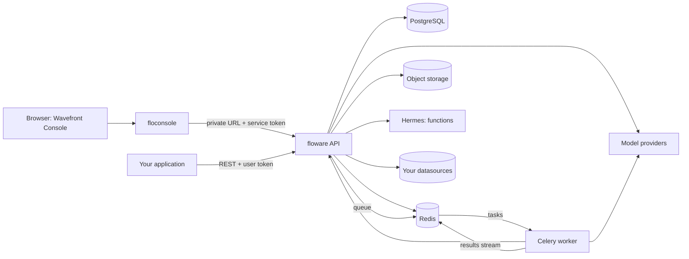

This section is for people who **run** Wavefront. For setting up a local or Docker deployment from scratch, start with the repository's `DOCKER_SETUP.md`.

## The services

| Service | Role | Default port |
|---|---|---|
| **floware** | The app's API server: agents, workflows, functions, datasources, configurations, chatbots, users, audit. One per app | 8001 |
| **Celery worker** | Runs background (v3) agent and workflow runs from the queue | — |
| **Hermes** | The sandbox that runs [functions](/wavefront/functions) (JavaScript). Deployed as its own service; floware and the worker reach it at `HERMES_URL` | — |
| **floconsole** | The Wavefront Console's backend: console users, the list of apps, and a proxy to each app | 8002 |
| **Wavefront Console** (web) | The UI | 3000 |
| **PostgreSQL** | floware's own database (users, agents, workflows, executions, configurations, audit), and a separate one for floconsole | 5432 |
| **Redis** | Cache, sessions, the Celery queue, and the result stream from worker to API | 6379 |
| **Object storage** (S3, GCS or Azure Blob) | Agent, workflow and function definitions, dynamic queries, execution inputs and outputs | — |
| OpenTelemetry collector, Jaeger | Traces and metrics (optional) | 4317 / 16686 |
| call_processing | Voice agents (optional) | 8004 |
| inference_app | Embeddings for knowledge bases (optional) | 8003 |

Your own databases and buckets, connected as [datasources](/wavefront/datasources), are separate from the ones above.

## How a background run flows

1. `POST /v3/workflows/<id>/inference` on floware saves any input files to object storage, records the execution as `pending`, and puts a task on the Celery queue in Redis.
2. The worker picks the task up, marks it `in_progress`, builds the workflow, and runs it. Workflow steps that call Wavefront (queries, inserts, file downloads, functions) go back to floware's API.
3. The worker writes `output.json` and `history.json` to object storage and publishes the result on a Redis stream.
4. floware consumes the stream and updates the execution to `completed` or `failed`; clients poll it.

So the worker needs to reach Redis, object storage, the model providers **and floware's API**. Most "stuck in pending" problems are one of those missing (see [Environment](/operations/environment)).

## How the console reaches an app

Each app registered in the console has a **public URL** (for users) and a **private URL** (for the console). floconsole forwards console requests to the app's private URL, signed with a short-lived token made from a secret shared with that app. Console users therefore never need accounts on the apps themselves.

## Scaling

- **floware** is stateless apart from its database and Redis; run several replicas behind a load balancer. `FLOWARE_WORKER_COUNT` sets processes per replica.
- **Workers** scale with background load; each takes tasks from its app's queue.
- **Model capacity** is usually the real limit: provider tokens-per-minute quotas cap how many image-heavy runs can proceed at once.
