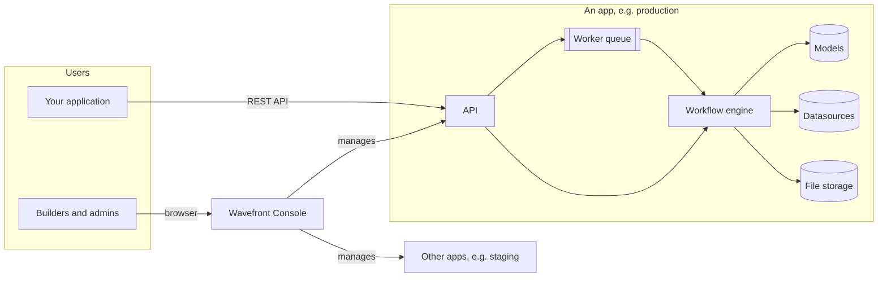

Wavefront is a backend for AI applications. You describe agents, workflows, data access and rules as configuration, and Wavefront runs them, stores what they need, and exposes everything over one REST API. Your own application (a web app, a back-office tool, a chat widget) calls that API.

This section of the documentation is about **building on Wavefront**. The engine underneath, FloAI, has its own documentation in the [FloAI tab](/flo-ai); you do not need it to get started, but it is where the agent and workflow YAML formats are described in full.

## Three things to know first

<CardGroup cols={3}>
  <Card title="Apps" icon="cube">
    An **app** is one running Wavefront backend with its own database, models, agents, workflows, data and users. A customer, a team or an environment usually gets its own app.
  </Card>
  <Card title="Wavefront Console" icon="browser">
    The **Wavefront Console** is the web UI for building and operating apps. One console can manage many apps.
  </Card>
  <Card title="The API" icon="code">
    Everything you can do in the console is an API call. Your application uses the same API to run workflows, query data and chat.
  </Card>
</CardGroup>

## The building blocks

Inside an app you combine a small set of building blocks. Each one is a page in the console's sidebar.

| Building block | What it is for | Typical example |
|---|---|---|
| **LLM Repository** | The models the app may use, with their keys and settings, kept in one place | "GPT for extraction", "a small local model for classification" |
| **Agents** | One model with a role, instructions, optional tools and an optional output schema | An agent that reads an invoice image and returns its fields as JSON |
| **Workflows** | Several steps run in order: agents, functions, routers, sub-workflows | Extract → validate → decide → save |
| **Functions** | Small deterministic JavaScript steps inside a workflow | Turn agent answers into a decision; map a result onto a table row |
| **Datasources** | Connections to databases and file storage, plus named SQL queries | Read the record a workflow should check; store uploaded files |
| **Configurations** | Named JSON documents a workflow reads at run time | Thresholds, rule tables, scoring weights an admin can edit |
| **Chatbots** | A model with a system prompt and per-user chat sessions | An assistant that answers questions about one record |
| **Knowledge Bases** | Documents indexed for retrieval | Policy manuals an agent can search |
| **Guardrails, Triggers, Scheduled Jobs, API Services, Voice Agents** | Safety checks, event-driven and timed runs, outbound APIs, voice | See their own pages |

A typical AI feature uses four or five of these together. For example, *"check an uploaded document against the submitted form"* is:

1. a **datasource** query that loads the form,
2. **file storage** holding the uploaded document,
3. an **agent** that reads the document and returns structured fields,
4. a **function** that compares those fields with the form and decides,
5. a **workflow** that runs those steps in order and saves the result back to the **datasource**,

with the thresholds the function uses kept in a **configuration**, so they can be changed without touching the workflow.

## How the pieces talk to each other

- **The console** talks to each app on your behalf. You sign in to the console once; it reaches each app with a short-lived, app-specific credential, so you do not need a separate login per app.
- **Your application** talks to an app directly through its API, using an app user or a service account (see [Integrating an application](/wavefront/integrating-an-app)).
- **Long runs** go through a worker queue. A workflow can run synchronously (the API call waits for the result) or asynchronously (the call returns an execution id and you poll for the result).

## What Wavefront is good at

- **Mixing AI judgement with deterministic rules.** Agents read documents, images, video and text and return structured evidence; functions apply rules you can test and explain. Decisions stay auditable.
- **Changing behaviour without redeploying.** Prompts, workflow steps and rule configurations are versioned data, not code.
- **One API for the whole feature.** Data access, file storage, model calls, chat sessions and the audit trail sit behind the same authentication and the same response format.

## Where to go next

<CardGroup cols={2}>
  <Card title="Concepts" icon="book" href="/wavefront/concepts">
    A short definition of every term used in these docs.
  </Card>
  <Card title="Tour of the Wavefront Console" icon="map" href="/wavefront/console-tour">
    Where each building block lives in the UI.
  </Card>
  <Card title="Quickstart" icon="rocket" href="/wavefront/quickstart">
    Add a model, build an agent and a workflow, and run it, in about fifteen minutes.
  </Card>
  <Card title="FloAI" icon="python" href="/flo-ai">
    The engine and the full YAML reference for agents and workflows.
  </Card>
</CardGroup>
