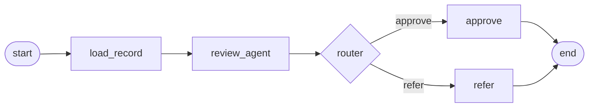

Knowing how the engine walks a workflow explains most surprises.

## One node at a time

A workflow runs **one node at a time**, starting at `start` and following `edges`:

- An edge **without a router** has exactly one target. Writing `to: [a, b]` without a router is rejected.
- An edge **with a router** lists every node the router may choose; at run time the router picks one.
- The run stops when it reaches a node listed in `end`.

There is no parallel fan-out: two agents never run at the same time within one run. To process several independent items, use a [ForEach](/wavefront/routing-and-iteration#foreach), or start several runs from your application.

## Memory

As nodes run, each output is added to the run's **memory**, tagged with the name of the node that produced it. The workflow's input messages are in memory too, under the name `input`.

What a node *sees* is a selection from that memory:

- **No `input_filter`:** everything in memory so far: the input and every earlier output.
- **`input_filter: [a, b]`:** only the outputs of nodes `a` and `b` (and `input` if listed).

Agents receive their selection as a conversation; function nodes receive it as parsed JSON. See [Passing data between nodes](/wavefront/workflow-data-flow).

<Tip>
Always set `input_filter` on agents in workflows with more than two or three steps. Without it, every agent is sent the whole history: more tokens, slower runs, and models distracted by irrelevant earlier output. For images and documents, which are large, it matters even more; see [Sub-workflows](/wavefront/sub-workflows).
</Tip>

## The output of a run

A run's output is **the output of the last node that ran**. That has two consequences:

- If the last step does something for its side effect, such as saving a row or sending an email, its confirmation becomes the run's output. Add a final [`passthrough`](/wavefront/function-nodes#passthrough) node that re-emits the result you want returned.
- With a router, different runs can end on different nodes; make sure each possible last node returns something useful.

## Variables

Variables passed with a run (`"variables": {...}`) are available to every node, all the way through: `<name>` placeholders in agents, and input fields of function nodes and functions. A run also gets a `_wf_execution_id` variable; for background runs it is the execution id, which is useful for saving results against the run that produced them.

## Limits

| Limit | Default | Notes |
|---|---|---|
| Node executions per run | 35 | Protects against loops. Set with the server environment variable `FLO_AI_MAX_ITERATIONS` (allowed 5–60) |
| A function's execution time | 3 seconds | Functions are for fast, deterministic work; a longer run fails with *"The script exceeded the 3 second timeout limit"* |
| Synchronous API call | your HTTP client's and proxy's timeouts | Use [background runs](/wavefront/running-workflows) for anything that can take more than a minute |

## Failure

If a node raises an error, the run stops and returns the error. Design for it:

- Make functions **fail loudly with a clear message** when their input is wrong, rather than returning a half-result that a later step misreads.
- Use routers to **skip** optional steps (for example, a file that was not uploaded) instead of letting them fail. See [Routing and iteration](/wavefront/routing-and-iteration).
