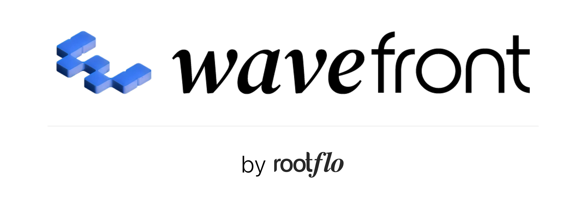
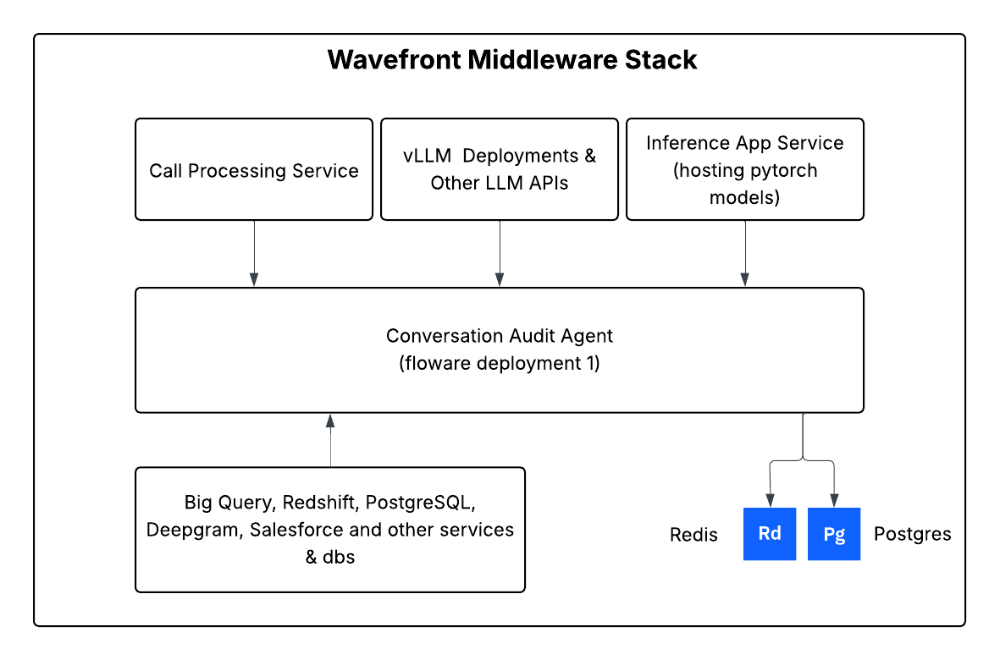
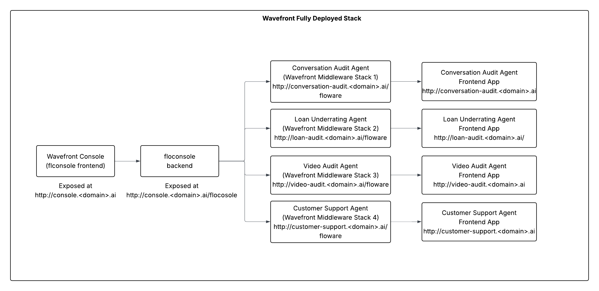

<p align="center">
  <a href="https://rootflo.ai">
  
  </a>
</p>

## Prerequisites

The project has its backend services written in python and frontend in reactjs. It has the following dependencies:

- Python >=3.11
- Node.js >=22.12
- uv >=0.8.6
- pnpm >=10.13.1

## Wavefront Overview

The platform consist of following components, which create a microservice mesh to provide scalable, secure, and reliable AI services. We have not used a fully microservice architecture as it is not necessary for our use case.

The platform consists of following components:

| Service             | Port | Description                                                                                                                                                       | Release Status |
| ------------------- | ---- | ----------------------------------------------------------------------------------------------------------------------------------------------------------------- | -------------- |
| **floware**         | 8001 | Core AI middleware service. This service connects wavefront to multiple backends, databases, AI models and more. This is the core control center of the platform. | Beta           |
| **floconsole**      | 8002 | Management console service, this module is multi-app control centre for configuriong multiple apps on the wavefront middleware.                                   | Beta           |
| **inference_app**   | 8003 | Inference App service. A simple service for running pytorch models. We right now support all models which works on pytorch version 0.16.0.                        | Experimental   |
| **call_processing** | 8004 | Voice call processing service                                                                                                                                     | Beta           |

#### Middleware High Level Architecture:

<p align="center">
  
</p>

#### Console High Level Architecture:

<p align="center">
  
</p>

The project is ready for production use only in Google Cloud Console and Amazon Web Services.
In the current state of the project, it requires following cloud services to run locally (We are working on removing this dependencies for local runs):

- Google Cloud Storage or Amazon S3
- Google Cloud Pub/Sub or AWS SQS

## Quick Start

> [!WARNING]
>
> - This project is under active development and APIs may change without notice. Please checkout the [platform docs](https://wavefront.rootflo.ai) for the latest information.
> - The platform is not in the GA state, and there are unimplemented feature. Checkout [ROADMAP.md](../ROADMAP.md) for the list of features, and whats missing.

### Docker Setup

You can use docker compose to setup the platform locally. Details on setting up using docker can be found in [DOCKER_SETUP.md](DOCKER_SETUP.md)

### Dev/Local Setup

From the `wavefront/` directory, use the interactive local scripts (prereqs, `.env` files, docker postgres/redis/localstack, and selected apps):

```bash
./dev-start.sh   # first-time setup + start selected services
./dev-stop.sh    # stop selected services (running ones pre-checked)
```

`dev-start.sh` will:

1. Check prerequisites (Python ≥3.11, uv, docker, openssl, Node, pnpm)
2. Let you choose which apps to start (floconsole, floware, web client, celery, RAG, inference, call processing)
3. Create `.env` files from samples when missing (optional replace)
4. Start postgres, redis, and localstack, then create DBs / LocalStack resources as needed
5. Install deps and launch the selected services in new terminal windows

When the stack is up, open http://localhost:5173, log in with the credentials from floconsole’s `.env`, and add floware as an app (Apps → Create new app). With `VITE_APP_ENV=local` in `client/.env`, you can tick “Create local app for development” to fill the URLs.

Wavefront uses VS Code (or Cursor / similar) as the primary editor. Open the provided workspace file; you should see:

- `wavefront-root-dir`: root directory files
- `wavefront`: backend & frontend
- `flo_ai`: the A2A orchestration library

## Next Steps

Connect your datasources, and create your first agent & workflow or go ahead an try out the voice bot feature.

- Checkout the platform docs here [https://wavefront.rootflo.ai](https://wavefront.rootflo.ai/).
- Incase you face any issues, dont hesitate to reach out to schedule a call with us [here](https://calendly.com/meetings-rootflo/30min)
